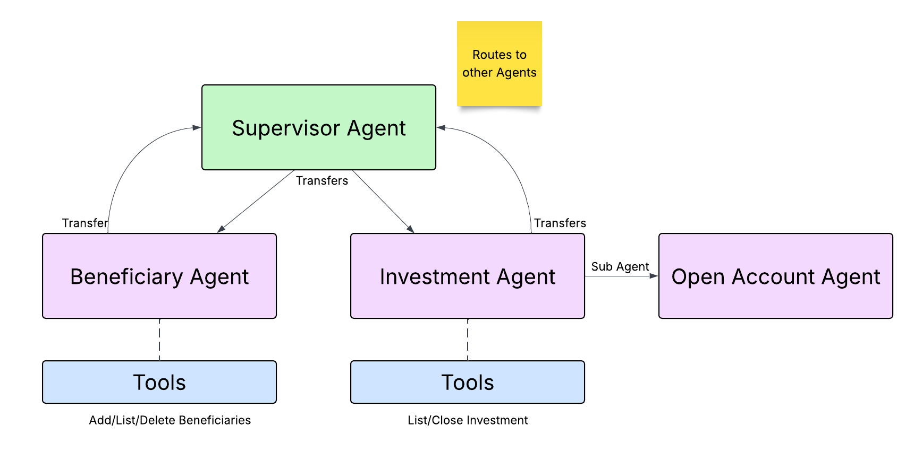

# Wealth Management Agent Example using Google ADK
Demonstrates how to use [Google ADK](https://adk.dev/) using subagents and instructions to delegate to other agents. 
Shows an example of just using the Google ADK and another version that leverages [Temporal](https://temporal.io) to 
wrap the agentic flow with Temporal and make it durable. 



Scenarios currently implemented include
* Add Beneficiary - add a new beneficiary to your account
* List Beneficiaries - shows a list of beneficiaries and their relationship to the account owner
* Delete Beneficiary - delete a beneficiary from your account
* Open Investment Account - opens a new investment account - using a **child workflow** in the Temporal version. 
  The child workflow can optionally run in [Java](java/README.md), showing a polyglot (Python + Java) application.
* List Investments - shows a list of accounts and their current balances
* Close Investment Account - closes an investment account
* Off-topic questions - anything not about beneficiaries or investment accounts is politely declined by the
  supervisor agent (handled in the agents' prompts)

The Google ADK only version opens accounts directly with a simple tool (no KYC, compliance review or saga).

The Temporal version also has a **Chaos Panel** that injects failures at runtime (API and LLM outages,
rate limits, a saga rollback, a bug in workflow code) to show how Temporal handles them. See
[Failure Scenarios](src/temporal_supervisor/README.md#failure-scenarios-chaos-panel).

You can run through the scenarios with the Temporal version using the web application in `src/frontend`
(see [Running the Demo](src/temporal_supervisor/README.md#running-the-demo)).

## Prerequisites

* [uv](https://docs.astral.sh/uv/) - Python package and project manager
* Python 3.14 or later (`requires-python` in `pyproject.toml`; uv can install it for you)
* [Google / Gemini Key](https://console.cloud.google.com/apis/credentials) or [AI Studio](https://aistudio.google.com/api-keys) - Your key to access Gemini models
* [Temporal CLI](https://docs.temporal.io/cli#install) - Local Temporal service (Temporal version)
* [Redis](https://redis.io/downloads/) - Stores conversation history and status updates (Temporal version)
* [Node.js](https://nodejs.org/) and npm - Runs the web frontend (Temporal version)
* Java JDK 25 - optional, only to run the Open Account workflow in [Java](java/README.md) (the Gradle wrapper is included, no separate Gradle install)

## Set up Python Environment
```bash
uv sync
```

## Set up your Gemini API Key
 
```bash
cp setgeminikey.example setgeminikey.sh
chmod +x setgeminikey.sh
```

Now edit the setgeminikey.sh file and paste in your Gemini API Key.
It should look something like this:
```text
export GEMINI_API_KEY="Your API Key Goes Here"
```

## Getting Started

* Google ADK only: [src/adk_supervisor/README.md](src/adk_supervisor/README.md)
* Temporal version: [src/temporal_supervisor/README.md](src/temporal_supervisor/README.md)
* Open Account workflow in Java: [java/README.md](java/README.md)
* API used by the web application: [src/api/README.md](src/api/README.md)
* Web application: [src/frontend/README.md](src/frontend/README.md)

## Resetting the Demo Data

Both versions keep the demo data in JSON files in `data/` and change them as you go (opening and closing
accounts, adding and deleting beneficiaries, and, in the Temporal version, moving money from the linked bank
account). To put everything back, run this in the project root:

```bash
git checkout data/
```

## Running the Tests

Run these from the project root. The Python tests start a local Temporal dev server, which is downloaded
on the first run.

```bash
uv run pytest                                      # Python: the supervisor workflow with a scripted model (no Gemini key or Redis needed)
(cd java && ./gradlew test)                        # Java: the Open Account workflow
(cd src/frontend && npm install && CI=true npm test)   # Frontend: the chat and the chaos panel toggle
source ./setgeminikey.sh && LIVE_TEST_RUNS=10 uv run pytest tests/live_agent_handoffs.py -s   # Live agent-handoff test (calls the paid Gemini API)
```
