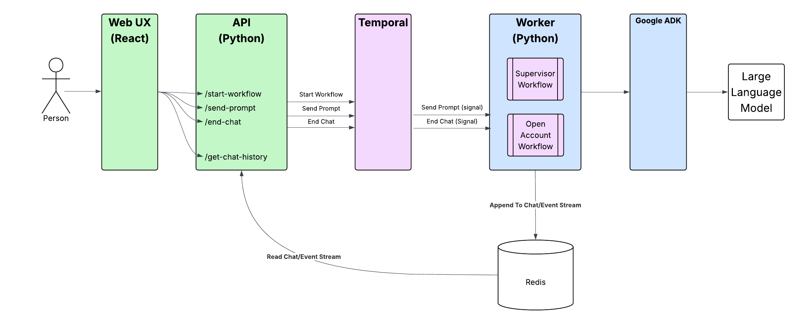
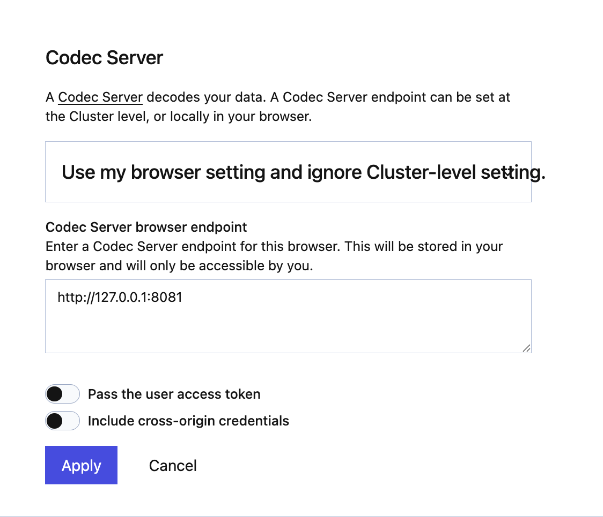
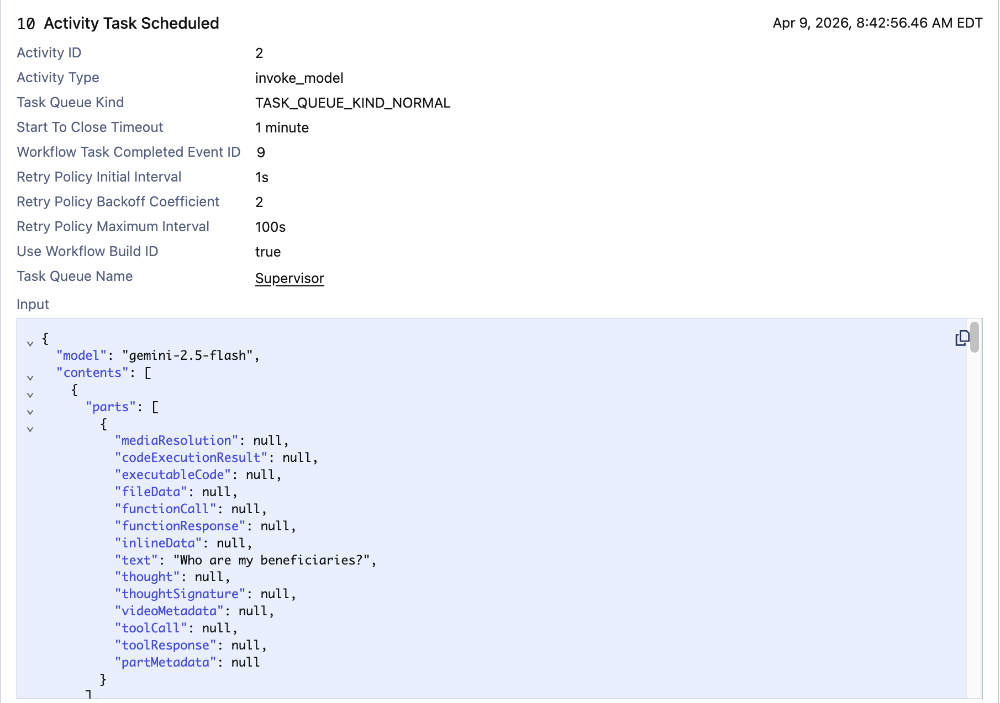
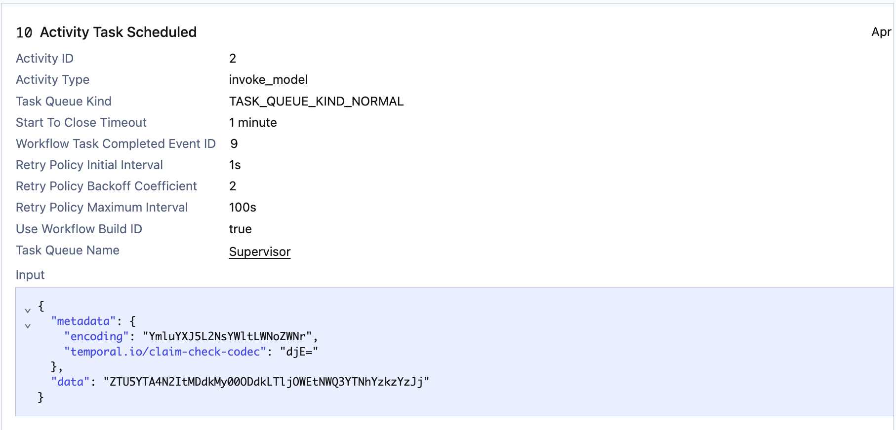

# Wealth Management Agent Example using Google ADK 
Demonstrates how to use Google ADK with Temporal using subagents and instructions to delegate to other agents. 

The supervisor agent is responsible for directing the actions to the appropriate helper agents.   

Scenarios currently implemented include
* Add Beneficiary - add a new beneficiary to your account
* List Beneficiaries - shows a list of beneficiaries and their relationship to the account owner
* Delete Beneficiary - delete a beneficiary from your account
* Open Investment Account - opens a new investment account using a **Child Workflow**
  (see [How the Open Account functionality works](#how-the-open-account-functionality-works))
* List Investments - shows a list of accounts and their current balances
* Close Investment Account - closes an investment account
* Off-topic questions - anything not about beneficiaries or investment accounts is politely declined by the
  supervisor agent (handled in the agents' prompts)

## Application Architecture

The overall application architecture looks like this:



There is a React UX which is where the customer interacts with the application. 
The React UX leverages an API which exposes endpoints to start a workflow, send a prompt,
retrieving the chat history, and ending the chat. The React frontend uses adaptive polling
to retrieve new events from Redis, providing real-time status updates as the Open Account 
child workflow progresses through the different steps. 

The API in turn, communicates with Temporal to start workflows and send signals. Finally, 
the worker contains the two workflows - supervisor and open account - which contain the 
agents and business logic that drive the agentic application. The worker polls two task queues:
`TEMPORAL_TASK_QUEUE` for the workflows and tools, and a separate queue for the Gemini model
calls, so they can be rate limited on their own (see [Failure Scenarios](#failure-scenarios-chaos-panel)).
The Open Account workflow can optionally run in a Java worker instead
(see [Running the Open Account Workflow in Java](#running-the-open-account-workflow-in-java-optional)).

## Prerequisites

* [uv](https://docs.astral.sh/uv/) - Python package and project manager
* Python 3.14 or later (`requires-python` in `pyproject.toml`; uv can install it for you)
* [Google / Gemini Key](https://console.cloud.google.com/apis/credentials) or [AI Studio](https://aistudio.google.com/api-keys) - Your key to access Gemini models
* [Temporal CLI](https://docs.temporal.io/cli#install) - Local Temporal service
* [Redis](https://redis.io/downloads/) - Stores conversation history and status updates
* [Node.js](https://nodejs.org/) and npm - Runs the web frontend
* Java JDK 25 - optional, only for the [Java Open Account worker](#running-the-open-account-workflow-in-java-optional)
  (the Gradle wrapper is included, no separate Gradle install)

## Set up Python Environment
Execute this in the project root (not this folder -- up two levels)
```bash
uv sync
```

## Set up your Gemini API Key

Here are the steps to create a new Gemini key. 

1. Create a New GCP Project (skip if you already have one)
2. Enable the Gemini API in this project
3. Open [AI Studio](https://aistudio.google.com)
4. Import or select the GCP Project
5. Create the API key


Execute this in the project root (not this folder -- up two levels)

```bash
cp setgeminikey.example setgeminikey.sh
chmod +x setgeminikey.sh
```

Now edit the setgeminikey.sh file and paste in your Gemini API Key.
It should look something like this:
```text
export GEMINI_API_KEY="Your API Key Goes Here"
```

## Set up Redis

Redis is used for storing conversation history and providing real-time status updates. If you don't have an existing Redis server, you can run one locally after installing it. 

In a new terminal / shell run the following command:

```bash
redis-server
```

By default, the application expects to find Redis running locally. You can override the location of Redis
by setting the environment variables:

```bash
export REDIS_HOST=localhost
export REDIS_PORT=6379
```

## Set up Claim Check (optional)

An optional configuration is to substitute the data sent to Temporal (e.g. function/method parameters and return values)
with an ID. This is known as the [Claim Check Pattern](https://www.enterpriseintegrationpatterns.com/patterns/messaging/StoreInLibrary.html). 
The original data is stored in Redis. This uses a 
[Custom Payload Codec](https://docs.temporal.io/develop/python/converters-and-encryption#custom-payload-codec) 
that intercepts data going to Temporal Cloud, replaces it with a GUID. When the data is retrieved, it looks up the GUID 
replaces it with the data stored in Redis.

```bash
cp setclaimcheck.example setclaimcheck.sh
chmod +x setclaimcheck.sh
```

Now edit the setclaimcheck.sh file and fill in the location of Redis
It should look something like this:
```bash
export USE_CLAIM_CHECK=true
export REDIS_HOST=localhost
export REDIS_PORT=6379
```

The start scripts load `setclaimcheck.sh` if it exists. To run without the claim check, don't
create the file, or set `USE_CLAIM_CHECK=false` in it.

Save the file and be sure that you have Redis running. For example:

```bash
redis-server
```

Note that the application assumes you only have one Redis server that is used by the application for storing the 
conversation history and is also used if Claim Check has been enabled. 

Be aware that using a claim check pattern introduces performance costs by doing remote calls to Redis for every payload. 
Also, make sure your Redis implementation is rock solid as any downtime will directly affect your workflows. 

## Run Codec Server for Claim Check (optional)
If you have decided to set up the Claim Check above, you will 
most likely want to also run a Codec Server to be able to see the actual data sent to 
the workflow and activities. 

Be sure you have updated the setclaimcheck.sh as mentioned above.

To run the Codec Server:
```bash
cd src/temporal_supervisor
./startcodecserver.sh
```

The script exits with a message if `setclaimcheck.sh` doesn't exist in the project root.

And of course, make sure that your Redis Server is up and running. 

Once it's up and running, the default endpoint is http://127.0.0.1:8081.

Open up your browser and navigate to the Temporal UI. Locally, open it at exactly http://localhost:8233
(not 127.0.0.1): the codec server only accepts requests from http://localhost:8233 and https://cloud.temporal.io.
For Temporal Cloud that will be https://cloud.temporal.io

In the upper right, there is an icon that looks like glasses. Click on that and you 
can configure your codec server. 

Change the drop down to "Use my browser setting and ignore Cluster-level setting".

Use the endpoint of your codec server (default is http://127.0.0.1:8081). Be sure there are no 
extra spaces at the end of the URL or it will not work. You can turn off the two options - Pass the 
user access token and Include cross-origin credentials. Click on apply and you have configured 
the codec server. 



As you run through different scenarios, you'll be able to see the decoded values in the browser.



If you remove the codec server settings, you won't be able to see anything other than a BASE64 Encoded ID.



## Running the Demo 

You have the option of running the demo [locally](#locally) or on [Temporal Cloud](#temporal-cloud). 

### Locally
Start Temporal Locally.

```bash
temporal server start-dev
```

#### Start the Worker

```bash
cd src/temporal_supervisor
./startlocalworker.sh
```

#### Start the API

```bash
cd src/api
./startlocalapi.sh
```
#### Start the UX

```bash
cd src/frontend
npm install     # first time only
npm start
```

A new browser window opens where you can interact with the application. The UI expects the API
at `http://127.0.0.1:8000` (set in `src/frontend/src/config.js`). See [the API README](../api/README.md)
and [the frontend README](../frontend/README.md) for details.

If you are opening a new investment account, in another terminal
#### Send the Compliance Reviewed Signal 
```bash
cd src/temporal_supervisor
./localsendcomplianceapproval.sh <Child Workflow ID>
```

The child workflow ID has the form `OpenAccount-<chat workflow ID>-<client ID>-<account name>`, for example
`OpenAccount-adk-temporal-agent-k3j9x2p1q8z-123-Vacation`. The chat UI doesn't show it. Find it in the Temporal UI
(http://localhost:8233 locally): look for the running `OpenInvestmentAccountWorkflow`, a child of the chat's
`WealthManagementWorkflow`. If you send the signal before KYC is done, the workflow holds it until KYC completes.

### Temporal Cloud

Copy the setcloudenv.example, located in the src/temporal_supervisor folder to the project root and name it setcloudenv.sh .

```bash
cp  src/temporal_supervisor/setcloudenv.example setcloudenv.sh
```

Edit setcloudenv.sh to match your Temporal Cloud account:
```bash
export TEMPORAL_ADDRESS=<namespace>.<accountID>.tmprl.cloud:7233
export TEMPORAL_NAMESPACE=<namespace>.<accountID>
export TEMPORAL_TLS_CLIENT_CERT_PATH="/path/to/cert.pem"
export TEMPORAL_TLS_CLIENT_KEY_PATH="/path/to/key.key"
```

To use an API key instead of mTLS, remove the two certificate lines, set `TEMPORAL_API_KEY`, and use the
API key endpoint (`<region>.<cloud>.api.temporal.io:7233`) as `TEMPORAL_ADDRESS`.

#### Start the Worker
```bash
cd src/temporal_supervisor
./startcloudworker.sh
```

#### Start the API

```bash
cd src/api
./startcloudapi.sh
```
#### Start the UX

```bash
cd src/frontend
npm install     # first time only
npm start
```

If you are opening a new investment account, in another terminal
#### Send the Compliance Reviewed Signal 
```bash
cd src/temporal_supervisor
./cloudsendcomplianceapproval.sh <Child Workflow ID>
```

Find the child workflow ID in the Temporal Cloud UI, as described for [running locally](#locally).

### Configuration

The worker and the API read these environment variables. The start scripts set the Gemini key,
claim check and cloud settings from the files in the project root.

| Variable | Default | Purpose |
|---|---|---|
| `GEMINI_API_KEY` | required | Gemini API key (worker). The model is `gemini-2.5-flash`. |
| `TEMPORAL_ADDRESS` | `127.0.0.1:7233` | Temporal frontend address |
| `TEMPORAL_NAMESPACE` | `default` | Namespace |
| `TEMPORAL_API_KEY` | empty | API key auth |
| `TEMPORAL_TLS_CLIENT_CERT_PATH`, `TEMPORAL_TLS_CLIENT_KEY_PATH` | empty | mTLS auth |
| `TEMPORAL_TASK_QUEUE` | `Supervisor` | Task queue for the workflows and tools |
| `TEMPORAL_TASK_QUEUE_LLM` | `<TEMPORAL_TASK_QUEUE>-llm` | Task queue for the Gemini model calls |
| `TEMPORAL_TASK_QUEUE_OPEN_ACCOUNT` | `TEMPORAL_TASK_QUEUE` | Task queue for the Open Account workflow (set by `startlocalworker.sh <queue>`) |
| `LLM_MAX_CALLS_PER_SECOND` | unlimited | Rate limit for model calls across all workers |
| `REDIS_HOST`, `REDIS_PORT` | `localhost`, `6379` | Redis for chat history, events and the chaos flags |
| `USE_CLAIM_CHECK` | `false` | Claim check codec |

The worker uses the Temporal SDK's [environment configuration](https://docs.temporal.io/develop/environment-configuration),
so a `TEMPORAL_PROFILE` from a config file works too.

### Resetting the Demo Data

The demo keeps its data in JSON files in `data/`, and changes them as you go: opening and closing
accounts, moving money from the linked bank account, and adding or deleting beneficiaries. To put
everything back, for example before a demo, run this in the project root:

```bash
git checkout data/
```

## How the Open Account functionality works

To show how to integrate other workflows within an agentic system, opening a new investment account
starts a child workflow, `OpenInvestmentAccountWorkflow` (`workflows/open_account_workflow.py`). The
Investment Agent hands off to an Open Account Agent, whose tools drive that workflow:

* `open_new_investment_account` (`activities/open_account.py`) runs in the chat workflow, so it can start the
  child with `workflow.start_child_workflow()`. First it runs the `validate_new_account` activity: an initial
  deposit under $100 or over $1,000,000 is rejected and the agent explains why. It returns the child workflow ID,
  which the other tools take.
* The child reports each state change by signalling `update_account_opening_state` on the chat workflow. The chat
  workflow records the latest state per account opening and shows it in the UI's status area. The agent reads it
  with the `get_account_opening_status` tool rather than from the conversation history.
* KYC: the child loads the client record and waits in *Waiting KYC*. The agent calls `get_current_client_info`
  (an Update on the child), shows the details and asks whether they're correct. When the customer confirms, in a
  later message, the agent calls `approve_kyc` (a `verify_kyc` signal). `approve_kyc` refuses until the details have
  appeared in a reply and the customer has answered since. If something is wrong, the agent calls
  `update_client_details` (an Update), which saves the changes and completes KYC.
* Compliance: the child then waits in *Waiting Compliance Review* until it receives the `compliance_approved`
  signal from `localsendcomplianceapproval.sh` / `cloudsendcomplianceapproval.sh`.
* Saga: the child then creates the account record (`open_investment`), transfers the initial deposit from the
  client's linked bank account (`debit_linked_account`, balances in `data/funding_accounts.json`) and registers
  the account with the custodian (`register_account`). If a step fails with a non-retryable error, the completed
  steps are undone in reverse order (`credit_linked_account`, then `remove_investment`) and the state ends with
  *Rolled back*. Otherwise it ends with *Complete*. See [Failure Scenarios](#failure-scenarios-chaos-panel),
  including the welcome-bonus bug.

Each opening is one workflow per chat, client and account name. Opening an account with the same name
again in the same chat (for example after a rollback) reuses the ID once the earlier opening has finished.

The chat itself runs as a single workflow run. A long conversation in production would need continue-as-new
(see the TODO in `workflows/supervisor_workflow.py`).

## Running the Open Account Workflow in Java (optional)

The Open Account workflow can run in a Java worker while the supervisor (AI) workflow and all
of the activities stay in Python. Pass the same task queue name to both workers. The Python
supervisor then starts the Open Account child workflow on that task queue, and the Java worker
picks it up.

```bash
cd src/temporal_supervisor
./startlocalworker.sh OpenAccount     # or ./startcloudworker.sh OpenAccount
```

```bash
cd java
./startlocalworker.sh OpenAccount     # or ./startcloudworker.sh OpenAccount
```

Without the argument, the Python worker runs the Open Account workflow itself. See
[java/README.md](../../java/README.md) for details.

## Failure Scenarios (Chaos Panel)

Click **Chaos** in the chat header to open the chaos panel. Its switches inject
failures at runtime: activities and the model read the flags from Redis on every
attempt, so you can turn a failure on and off mid-conversation without restarting
anything. The panel also lists each injected failure as it happens (activity and
attempt number). Open the [Temporal UI](http://localhost:8233) alongside it to show
the pending activity, its attempt count, and the last failure. **Reset all** turns
every flag off.

The flags are stored in Redis (`chaos:flags`, with the failure log in `chaos:events`). Other
wealth-management demos that use the same Redis server and keys share them, so a flag or
**Reset all** affects those demos too.

| Scenario | How to show it | What Temporal does |
|---|---|---|
| **Tool / API down** | Turn on *Core banking API down*, then ask to list your investments (or open an account, so it fails after compliance approval). Turn it off. | The activity retries (1s backoff, capped at 5s) for as long as the outage lasts. The agent waits mid-turn and answers once the API is back. Nothing is lost or re-asked. |
| **LLM down** | Turn on *Gemini API down* and send a message. Turn it off. | The model call is an activity, so it retries the same way (capped at 10s). The conversation picks up exactly where it was. |
| **LLM rate limited (reactive)** | Turn on *Gemini rate limited (429)* and send a message. | The model raises an `ApplicationError` with `next_retry_delay` (15s, like a `Retry-After` header), which overrides the retry policy's backoff. Real Gemini 429s (`RESOURCE_EXHAUSTED`) are turned into the same error by `ChaosAwareGemini` in `model_config.py`, which the worker registers in ADK's model registry. |
| **LLM rate limited (proactive)** | Start the worker with `LLM_MAX_CALLS_PER_SECOND=0.2 ./startlocalworker.sh` (in `src/temporal_supervisor`), then chat in several browser tabs at once. | Model calls run on their own task queue (`<TEMPORAL_TASK_QUEUE>-llm`, or `TEMPORAL_TASK_QUEUE_LLM`). The Temporal service dispatches at most that many per second across *all* workers, so calls queue up instead of hitting the provider's limit. Tools on the main queue aren't slowed down. |
| **Business rule (non-retryable)** | Ask to open an account with $2,000,000 (or less than $100). | `validate_new_account` raises a non-retryable `ApplicationError`: one attempt, no retries. The reason goes back to the agent, which explains it to the customer. Compare it with *Tool / API down* in the Temporal UI. |
| **Saga** | Turn on *Custodian rejects new accounts* (and *Slow account-opening steps* so you can watch), then open an account through compliance approval. Without flags: as client `123`, open an account with $300,000 (the linked bank account has $250,000). | The completed steps are undone in reverse order (refund, then remove the account). Compensations are activities too, so they are retried until they succeed. Kill the worker mid-rollback and the rollback still finishes. Transfers are idempotent (keyed by the workflow and run ID), so a retried debit or refund never moves money twice. |
| **Bug in workflow code** | Turn on *Bug in workflow code*, then open an account through compliance approval. See below. | The workflow pauses at the failing line, keeping all its state, until a worker with fixed code picks it up. |

### Bug in the workflow code

While **Bug in workflow code** is on, `find_promotion` gives new account openings a
`WELCOME-BONUS` promo code, which is passed to `OpenInvestmentAccountWorkflow` as
part of its input. The welcome-bonus code path (`_welcome_bonus` in
`workflows/open_account_workflow.py`) has a real bug: it reads
`inputs.initial_deposit`, a field that doesn't exist. Openings without the promo
code never reach it.

Right after compliance approval, the workflow raises `AttributeError:
'OpenInvestmentAccountInput' object has no attribute 'initial_deposit'`. In the
Python SDK an ordinary exception fails the *workflow task*, not the workflow, so
the workflow stays **Running**, paused at that point with the compliance approval
intact. The Temporal UI shows the failing workflow task and its stack trace.
Other conversations, and openings without the promo code, keep working.

Turning the switch off doesn't help: the promo code is part of the workflow's
input, so every retry hits the same line. The fix is code. Change
`inputs.initial_deposit` to `inputs.initial_amount` and restart the worker. The
workflow resumes on the server's next workflow-task retry and opens the account
with the bonus. Workflow-task retries back off over time, up to 10 minutes; if the
fix is deployed within a couple of minutes, the workflow resumes within about a minute.

After the demo, re-arm the bug:

```bash
git checkout src/temporal_supervisor/workflows/open_account_workflow.py
```

### With the Java Open Account workflow

All the scenarios work the same way when the Java version of `OpenInvestmentAccountWorkflow`
is used (see [Running the Open Account Workflow in Java](#running-the-open-account-workflow-in-java-optional)). The Java workflow calls
the Python activities by name on the Python worker's task queue, so the chaos flags, which are
read inside those activities and the model activity, apply unchanged. The saga uses the
Temporal Java SDK's `Saga` class.

The bug in the workflow code is different in Java. `BONUS_RATES` in
`java/src/main/java/io/temporal/demo/wealthmanagement/workflow/OpenInvestmentAccountWorkflowImpl.java`
is keyed by `"WELCOME_BONUS"` (underscore), but the promo code is `"WELCOME-BONUS"` (hyphen),
so `welcomeBonus` throws a `NullPointerException`. As in Python, an unchecked exception fails
the workflow task, not the workflow, so it stays **Running**. The fix is the commented-out line
above it. Restart the Java worker after fixing it, and re-arm the bug afterwards with:

```bash
git checkout java/src/main/java/io/temporal/demo/wealthmanagement/workflow/OpenInvestmentAccountWorkflowImpl.java
```

### Tests

The failure scenarios have tests that run against the Temporal dev server (downloaded
on first run) with stub activities and a scripted model. No Gemini key or Redis is needed.

```bash
uv run pytest      # in the project root
```

The agent handoffs have a live test, `tests/live_agent_handoffs.py`, that runs the real
`WealthManagementWorkflow` against the real Gemini model, with the real beneficiary and investment
activities (they only read `data/*.json`). The Redis event stream is replaced by in-memory stand-ins
and the chaos flags are turned off, so Redis isn't needed. The customer asks "Who are my
beneficiaries?", gives client ID "123", then asks "What investments do I have?". The test checks that
the beneficiaries (John, Jane, Joan) are listed, and that in the same turn the Beneficiary Agent hands
off to the supervisor, which hands off to the Investment Agent, so the reply lists Checking, Savings
and 401K without mentioning a transfer or asking for the client ID again. It also checks what each
agent said (recorded from the model activity), so a Beneficiary Agent that announces the transfer
fails even when a later agent's reply hides it. Each run's transcript is printed.

It calls the paid Gemini API, so `uv run pytest` doesn't collect it (pytest only collects `test_*.py`),
and it is skipped when `GEMINI_API_KEY` is not set. Model output varies, so `LIVE_TEST_RUNS=<n>`
repeats the conversation n times (default 1):

```bash
source ./setgeminikey.sh && LIVE_TEST_RUNS=10 uv run pytest tests/live_agent_handoffs.py -s   # in the project root
```

The Java workflow has the same tests, using the Temporal Java SDK's test environment:

```bash
cd java
./gradlew test
```

The web frontend has tests for the chat and the chaos panel toggle:

```bash
cd src/frontend
npm install     # first time only
CI=true npm test
```
